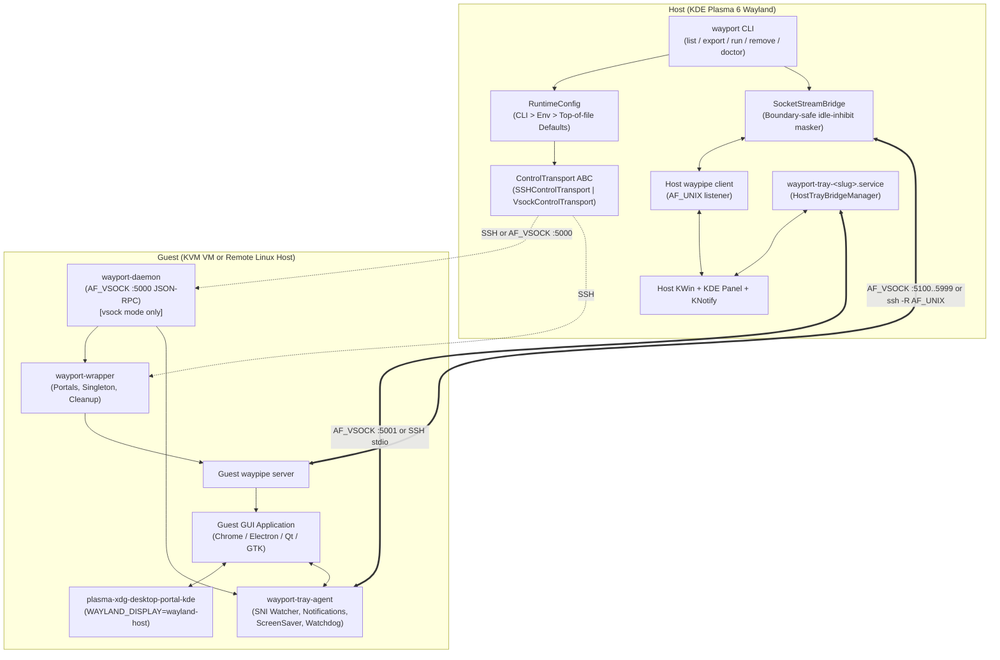
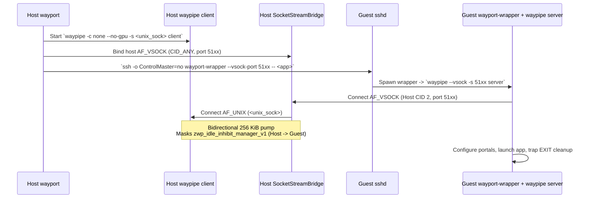
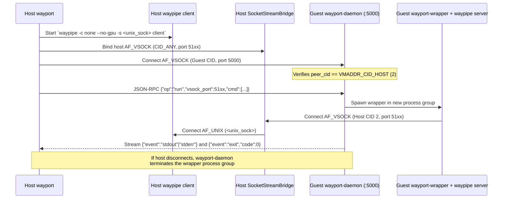
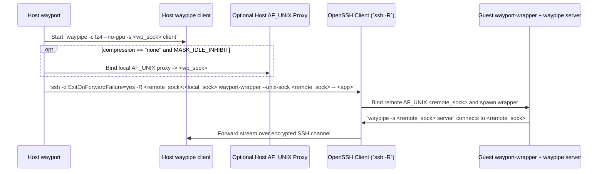

# `wayport` Architecture

This document describes the internal architecture, transport modes, wire protocols, process lifecycle, and security model of `wayport` (`v0.2.1`).

---

## 1. Design Philosophy & Motivation

Running GUI applications from a Linux KVM guest or remote Linux host seamlessly on a modern **KDE Plasma 6 (Wayland)** desktop requires solving five distinct problems that break traditional VM display protocols (SPICE, RDP, Xpra) and raw `waypipe ssh`:

1. **Per-monitor fractional scaling:** Each guest window must be presented to the host compositor (KWin) as an independent `wl_surface` so `wp_fractional_scale_v1` scales crisply across mixed-DPI displays (e.g., 1080p @ 100% + 4K @ 150%).
2. **Cross-version `waypipe` interoperability & transport flexibility:** Hosts (e.g. Ubuntu LTS with C `waypipe 0.8.x`) and guests (e.g. Debian Testing/Arch with Rust `waypipe 0.10+/0.11+`) must interoperate reliably over either `AF_VSOCK` or SSH Unix-socket forwarding.
3. **Desktop integration beyond window pixels:** Chromium/Electron and KDE apps rely on D-Bus services (`StatusNotifierItem`, `com.canonical.dbusmenu`, `org.freedesktop.Notifications`, `org.freedesktop.ScreenSaver`, `org.freedesktop.portal.FileChooser`) that otherwise trap dialogs inside the guest or freeze the UI for 60–120s in headless VMs.
4. **Host power-management safety:** Background Electron/Chromium apps routinely request Wayland idle inhibition (`zwp_idle_inhibit_manager_v1`) and D-Bus `ScreenSaver.Inhibit`, preventing laptops from blanking or suspending.
5. **Deterministic teardown:** Helper subprocesses (`chrome_crashpad_handler`, `zygote`, renderers) must not keep sessions hanging after the user closes the window or clicks "Quit" in the tray.

To remain lightweight and easy to install (`~/.local/bin/wayport`), `wayport` is packaged as a **single self-contained executable Python script** with a dedicated top-of-file configuration section and three embedded guest helper scripts rendered dynamically from that configuration.

---

## 2. High-Level Component Topology

`wayport` splits responsibilities into a **Control Plane** (listing apps, reading `.desktop`/icons, deploying guest scripts, triggering launches) and a **Data Plane** (Wayland protocol frames + System Tray / Notifications JSON stream).



---

## 3. Transport Modes

`wayport` supports three first-class transport modes selectable via `--mode` (`-m`), `WAYPORT_MODE`, or `DEFAULT_TRANSPORT_MODE` at the top of the script.

> **Why host `waypipe 0.8.x` still supports both `hybrid` and pure `vsock`:** C-based `waypipe 0.8.x` (shipped on Ubuntu 24.04 / LTS hosts) does not have a `--vsock` flag, whereas Rust `waypipe 0.10+/0.11+` in modern guests does. Because `wayport` opens the host `AF_VSOCK` listener directly in Python and bridges `AF_VSOCK ↔ AF_UNIX` in memory to host `waypipe client`, **both `hybrid` and pure `vsock` modes work seamlessly even with `waypipe 0.8.x` on the host** (while also enabling wire-level `zwp_idle_inhibit_manager_v1` masking).

| Mode | Control Plane | Wayland Data Plane | Tray & Notifications Data Plane | Requirements |
| :--- | :--- | :--- | :--- | :--- |
| **`hybrid`** *(default)* | SSH (`BatchMode=yes`) | `AF_VSOCK` (`:5100..5999`) → Host `AF_UNIX` bridge | `AF_VSOCK` (`:5001`), launched via SSH | `sshd` in guest + `vhost_vsock` on host + Virtio VSOCK device (`<cid auto="yes"/>` is sufficient) |
| **`vsock`** *(alias: `socket`)* | `AF_VSOCK` JSON-RPC (`:5000` to `wayport-daemon`) | `AF_VSOCK` (`:5100..5999`) → Host `AF_UNIX` bridge | `AF_VSOCK` (`:5001`), launched via `:5000` RPC | `vhost_vsock` + Virtio VSOCK (recommended pinned `<cid auto="no" address="3"/>`) + `wayport-guest.service` in guest (**no SSH / no NIC required**) |
| **`ssh`** | SSH (`BatchMode=yes`) | `ssh -R <guest_unix>:<host_sock>` Unix socket tunnel | SSH `stdin`/`stdout` (`wayport-tray-agent --stdio`) | `sshd` with `AllowStreamLocalForwarding yes` (**no VSOCK / no KVM required**) |

### 3.1 `hybrid` Mode Launch Sequence



### 3.2 `vsock` (Pure Socket) Mode Launch Sequence



### 3.3 `ssh` (Pure SSH) Mode Launch Sequence



---

## 4. Wire Protocols

### 4.1 Pure-VSOCK Control RPC Protocol (`AF_VSOCK` Port `5000`)

`wayport-daemon` speaks newline-delimited JSON (`\n`-terminated UTF-8 frames) over `SOCK_STREAM`:

| Operation (`op`) | Request Fields | Response |
| :--- | :--- | :--- |
| `ping` | `{}` | `{"ok": true, "version": "0.2", "uid": 1000, "runtime_dir": "/run/user/1000", "allow_script_sync": true}` |
| `list_apps` | `{}` | `{"ok": true, "apps": [{"id": "...", "name": "..."}, ...]}` |
| `get_desktop` | `{"app_id": "google-chrome"}` | `{"ok": true, "content": "[Desktop Entry]\n..."}` |
| `get_icon` | `{"icon_name": "google-chrome"}` | `{"ok": true, "ext": ".svg", "b64": "..."}` |
| `sync_scripts` | `{"scripts": {"wayport-wrapper": "...", "wayport-tray-agent": "..."}}` | `{"ok": true, "updated": [...]}` (restricted to the 2 allowed script names; gated by `ALLOW_VSOCK_SCRIPT_SYNC`) |
| `run` | `{"vsock_port": 5100, "compression": "none", "no_gpu": true, "cmd": [...]}` | Streaming events: `{"ok": true, "event": "started", "pid": ...}`, `{"event": "stdout"\|"stderr", "data": "..."}`, `{"event": "exit", "code": 0}`. Host may send `{"op": "terminate"}` or close the socket to terminate the guest process group. |
| `start_tray` | `{"vsock_port": 5001}` | Streaming events: `{"ok": true, "event": "started", "pid": ...}`, `stderr` logs, and `exit`. Tied to control socket lifetime. |

### 4.2 System Tray & Notifications Bridge Protocol (`AF_VSOCK` Port `5001` or SSH `stdio`)

* **Guest → Host:** Newline-delimited JSON prefixed with `TRAY_JSON:` so diagnostic stderr never corrupts the protocol stream.
  * `{"event": "item_added", "key": ":1.42/StatusNotifierItem", "state": {...}, "menu": {...}}`
  * `{"event": "item_updated", "key": "...", "state": {...}}` (omits `ThemeFiles` when icon hash is unchanged)
  * `{"event": "menu_updated", "key": "...", "menu": {"revision": N, "root": {...}}}`
  * `{"event": "item_removed", "key": "..."}`
  * `{"event": "notify", "id": N, "app_name": "...", "app_icon": "...", "summary": "...", "body": "...", "timeout": -1}`
* **Host → Guest:** Newline-delimited JSON commands forwarded to guest D-Bus objects asynchronously:
  * `Activate`, `SecondaryActivate`, `ContextMenu`, `Scroll`, `ProvideXdgActivationToken` (SNI)
  * `AboutToShow`, `MenuEvent` (`com.canonical.dbusmenu`)

---

## 5. Wayland Pipeline, VirGL & Idle-Inhibit Masking

### Why `waypipe -c none --no-gpu` + VirGL in KVM?

On KVM guests using `virtio_gpu` with `+virgl -resource_blob -host_visible`, allowing `waypipe` to capture raw DMABUF file descriptors forces synchronous `TRANSFER_FROM_HOST_3D` hypercalls and uncached `gbm_bo_map` readbacks, causing severe frame-pacing stutter. Passing `--no-gpu` to `waypipe` keeps Mesa VirGL OpenGL acceleration active inside the guest while exporting the final composited surface via cached `wl_shm` over zero-compression `vhost-vsock`.

In pure `ssh` mode over TCP/LAN/VPN/WAN (for physical remote Linux PCs, workstations, servers, or containers without KVM), network bandwidth is typically the bottleneck rather than CPU:
* `WAYPIPE_COMPRESSION_SSH` defaults to `"lz4"` for low-latency streaming over gigabit LAN, Wi-Fi, or local VPNs (WireGuard/Tailscale).
* For bandwidth-constrained WAN links, `--compression zstd` significantly reduces wire traffic at modest CPU cost.
* When targeting a **physical remote Linux PC** (rather than a KVM guest with `virtio_gpu`), `VULKAN_USE_LVP` can be set to `False` to let Vulkan applications use the remote machine's hardware GPU ICD; similarly, `ENABLE_SINGLETON_TAKEOVER` and `ENABLE_PORTAL_ROUTING` can be disabled if another user actively shares the same Linux account on the remote machine's physical display.

### Boundary-Safe `zwp_idle_inhibit_manager_v1` Masking

When `MASK_IDLE_INHIBIT = True` and `compression == "none"`, `pump_socket_stream()` inspects the Host → Guest Wayland stream (where `wl_registry.global` advertisements flow) and replaces the 27-byte ASCII interface name:

```text
zwp_idle_inhibit_manager_v1  (27 bytes)
            │
            ▼
zwp_idle_inhibit_disabledv1  (27 bytes, identical length & padding)
```

Because `recv()` may split that 27-byte string across two consecutive chunks, `pump_socket_stream()` retains only the **longest suffix of the current chunk that is a proper prefix** of `b"zwp_idle_inhibit_manager_v1"` (at most 26 bytes) in a `pending` carryover buffer:
* On normal chunks (99.999% of traffic), `keep == 0` and all bytes are forwarded immediately with **zero added latency**.
* If the string spans arbitrary chunk boundaries (even 1 byte per `recv()`), it is always reassembled and masked accurately.
* On EOF, any buffered trailing prefix is flushed before `SHUT_WR`.

Both sockets in a bridged pair are closed deterministically once both pump threads finish via a thread-safe reference count, eliminating file descriptor leaks.

---

## 6. System Tray, Headless VMs & Portal Routing

### Embedded Guest D-Bus Services (`wayport-tray-agent`)

To support **100% headless KVM guests** (`sddm` disabled) and eliminate Electron main-thread stalls:
1. **`org.kde.StatusNotifierWatcher`:** Claimed automatically if no desktop watcher (e.g. `kded6`) owns the name, allowing apps to register tray icons without a guest desktop shell.
2. **`org.freedesktop.Notifications`:** Replies in `<0.1ms` (avoiding 60–85s `libnotify` timeouts) and forwards notifications to the host KDE notification daemon.
3. **`org.freedesktop.ScreenSaver`:** Replies in `<0.1ms` to `Inhibit`/`UnInhibit` calls without blocking host sleep.
4. **Icon extraction & caching:** Converts ephemeral Electron/Chromium icon files to SNI `ARGB32` `IconPixmap` using vectorized `bytearray` row slicing (`rgba_to_argb32`), enforces file count/size caps (`TRAY_MAX_THEME_FILES`, `TRAY_MAX_ICON_BYTES`), refuses recursive dumps of system icon roots (`/usr/share/icons`), and caches per-item icon hashes so `NewTitle`/`NewToolTip` updates do not re-transmit unchanged files.

### KDE FileChooser Portal Routing (`wayport-wrapper`)

When `ENABLE_PORTAL_ROUTING = True`:
* Writes `~/.config/xdg-desktop-portal/portals.conf` routing `FileChooser` and `Settings` to `kde` while setting `Inhibit`, `Notification`, `Background`, and `GlobalShortcuts` to `none`.
* Points `${XDG_RUNTIME_DIR}/wayland-host` to the active `waypipe` socket, updates `systemd --user` + D-Bus activation environments, and triggers a fast non-blocking restart (`systemctl --user restart --no-block`) with a short readiness poll (up to `1.0s`) so `plasma-xdg-desktop-portal-kde.service` renders native KDE `KFileWidget` dialogs on the host without delaying application startup.
* On exit, `cleanup()` checks whether another active `waypipe` session exists (matching both basename and full path in `/proc/*/environ`) and re-points `wayland-host` to it, or restores `wayland-0` if it was the last session.

### Host Tray Service Isolation & Port-Conflict Safety

* Each VM uses a dedicated systemd user unit (`wayport-tray-<vm-slug>.service`), updated explicitly during `export`.
* During ad-hoc `run` invocations, `ensure_tray_daemon_running()` never overwrites an already-active unit for that VM and inspects active `wayport-tray-*.service` units via `find_conflicting_active_tray_service()` so two daemons never collide on the same `AF_VSOCK` tray port (use `--no-tray` for ephemeral runs or `--tray-port <PORT>` for simultaneous VMs).

---

## 7. Process Lifecycle & Deterministic Teardown

1. **Session tagging & host process-group teardown:** Every launched session exports `WAYPORT_INSTANCE_ID="wayport_<transport>_<id>_<pid>_<rand>"`. On the host, `waypipe client` is spawned in its own session (`start_new_session=True`) and terminated via `os.killpg` so forked `waypipe` worker processes exit immediately with zero lingering descriptors.
2. **Safe singleton takeover (`ENABLE_SINGLETON_TAKEOVER`):** Before launching, `wayport-wrapper` skips generic shells/interpreters (`sh`, `bash`, `env`, `python3`, etc.), protects its full ancestor PID chain up to PID 1, and inspects `/proc/<pid>/comm` and `basename(readlink(/proc/<pid>/exe))` for processes owned by the same UID, terminating only conflicting local-only instances that lack `WAYPORT_SESSION=1` or point to a dead Wayland socket.
3. **Automatic Electron/Chromium detection & `wl_shm` `ready-to-show` workaround:** In addition to the host-side `CHROMIUM_BINARIES` allowlist, `wayport-wrapper` inspects the resolved executable directory for `resources/app.asar`, `icudtl.dat`, or `chrome_crashpad_handler` (`AUTO_DETECT_ELECTRON = True`) and automatically appends `--ozone-platform=wayland` and `--password-store=kwallet6`. For Electron apps (such as Qoder on Electron 43 / Chromium 150) that create a hidden `BrowserWindow({ show: false })` and deadlock waiting on `ready-to-show` in `wl_shm` (`--no-gpu`) mode, `ELECTRON_SHM_NUDGE_APPS` triggers a single lightweight second-instance activation nudge after `ELECTRON_SHM_NUDGE_DELAY_SEC`, revealing the window immediately at full native `wl_shm` frame rates without falling back to slow DMABUF readbacks.
4. **Fast-forking CLI launcher keepalive:** Launchers such as `code` or `antigravity` fork and exit in `< FAST_FORK_THRESHOLD_SEC` (3s). The wrapper keeps `waypipe server` alive while any non-crashpad process with the same `WAYPORT_INSTANCE_ID` remains running.
5. **Tray-Quit watchdog:** When a tray icon unregisters **within `TRAY_QUIT_WINDOW_SEC` (5s) after a `MenuEvent`** (e.g., clicking "Quit"), `wayport-tray-agent` waits `TRAY_QUIT_WATCHDOG_DELAY_SEC` (0.8s) and terminates any lingering `WAYPORT_INSTANCE_ID` helpers. Non-menu tray disappearances (e.g. hiding a tray icon in settings) do **not** kill the app.
6. **Trap cleanup:** On `EXIT`/`INT`/`TERM`, `wayport-wrapper` cleans up all processes tagged with `WAYPORT_INSTANCE_ID` or the session's `WAYLAND_DISPLAY`, terminates its parent `waypipe server`, and unlinks temporary sockets.

---

## 8. Security Model

* **VSOCK peer authentication:** `wayport-daemon` inspects the kernel-provided peer CID on every `accept()` and rejects any connection whose CID is not `VMADDR_CID_HOST` (`2`) or `VMADDR_CID_LOCAL` (`1`).
* **Strict script sync allowlist:** `sync_scripts` only writes to `wayport-wrapper` and `wayport-tray-agent` inside `GUEST_BIN_DIR` via atomic temp-file replacement.
* **Path traversal prevention:** `sync_theme_files_safe()` rejects absolute paths, `..` segments, and any resolved target outside `HOST_TRAY_ICONS_DIR/<item_hash>`.
* **Safe argument passing:** All remote SSH helper invocations pass user/desktop data via `sys.argv` with `shlex.quote` — never interpolating untrusted strings into Python source code.
* **Isolated SSH channels:** Control/data commands enforce `BatchMode=yes`, `ConnectTimeout`, `ServerAliveInterval`, and `ControlMaster=no` for long-lived streams to prevent multiplexing head-of-line stalls and password prompt hangs.

---

## 9. Configuration Hierarchy

Settings are merged in strictly defined precedence order:

```text
1. CLI flags (--mode, --target, --cid, --compression, --no-gpu/--gpu, --control-port, --tray-port, --no-tray)
       │ overrides
2. Environment variables (WAYPORT_MODE, WAYPORT_TARGET, WAYPORT_CID,
                          WAYPORT_COMPRESSION, WAYPORT_NO_GPU,
                          WAYPORT_MASK_IDLE_INHIBIT, WAYPORT_CONTROL_PORT,
                          WAYPORT_TRAY_PORT)
       │ overrides
3. Top-of-file USER CONFIGURATION constants in `wayport`
```

Whenever any configuration constant affecting guest scripts is edited, `compute_guest_scripts_hash()` produces a new SHA-256 fingerprint, automatically invalidating the host deployment marker and re-syncing guest helpers on the next invocation.
